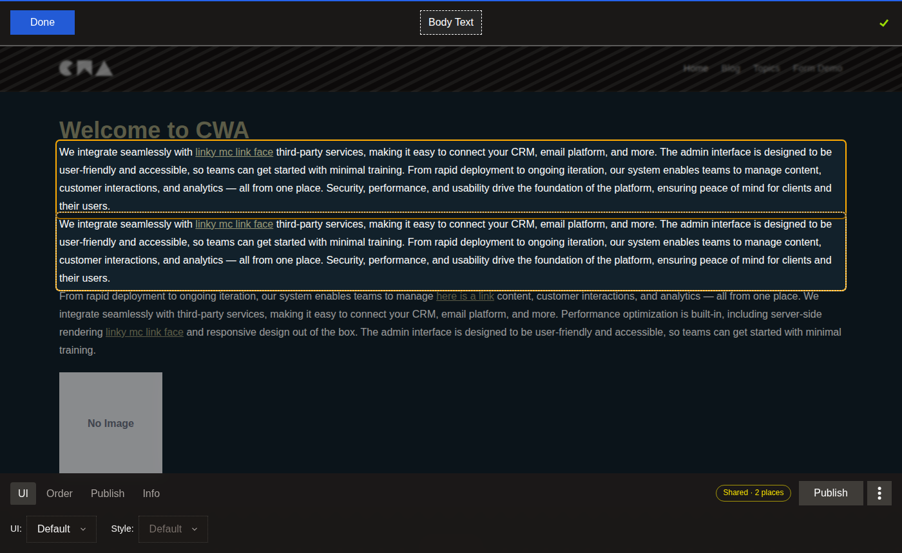

# Components Web App

**An open-source, self-hosted CMS for Symfony and Nuxt. Editors change content on the live page, every page is served from cache, and publishing purges only the pages that changed.**

[](#versions-and-support)
[](LICENSE)
[](https://www.npmjs.com/package/create-cwa)
[](https://cwa.rocks)

This repository is the CWA template: the project that `create-cwa` generates. It puts a Symfony + API Platform API (with [api-components-bundle](https://github.com/components-web-app/api-components-bundle)) and a Nuxt front end (with [`@cwa/nuxt`](https://github.com/components-web-app/cwa-nuxt-module)) behind FrankenPHP, with the caching, real-time updates and deploy pipelines already wired. A developer builds each site's components; editors then manage the content on the page itself.



## Try it live

**[preview.cwa.rocks](https://preview.cwa.rocks)** is a public demo of this template. Sign in at [/login](https://preview.cwa.rocks/login) as `admin` / `admin` and press **Edit**. It's a throwaway site: anyone can change it, and it's reset to the sample content every day at 05:30 (London time).

## Status

CWA 2 is a **prerelease** (`2.0.0-alpha`), heading for a beta. It runs production sites, but configuration and behaviour can still change between releases: every change a project must make by hand is in the [CHANGELOG](CHANGELOG.md)'s upgrade notes. See [Versions and support](#versions-and-support).

## Requirements

- Docker, with about **4 GiB** of memory available to it.
- Free ports **80** and **443**. The dev stack also publishes **3001** (Nuxt), **5432** (PostgreSQL) and **8025** (Mailpit).
- **Node 22.13** or later and **pnpm**, to run `create-cwa`.
- A POSIX shell for `bin/up` (macOS, Linux, or WSL / Git Bash on Windows).

## Quick start

```bash
pnpm create cwa my-site
```

`create-cwa` asks which features and CI pipeline you want, checks Docker and the ports, creates the project and runs `bin/up`. That starts the stack, waits until it's healthy, loads the admin user (and sample pages, if you chose them) and prints where to sign in:

| URL | |
|---|---|
| https://localhost | The site |
| https://localhost/login | Sign in (dev: `admin` / `admin`) |
| http://localhost:8025 | Mailpit: every email the API sends in dev |

The first run builds the images and installs dependencies, so it takes several minutes. The browser warns about the certificate on the first visit: Caddy signs it with its own local CA, which is expected in development. Run `bin/up` again any time; `bin/up --skip-fixtures` keeps an admin password you changed. If a phase fails, `bin/up` names it and prints that service's last log lines.

Full instructions: [cwa.rocks › Installation](https://cwa.rocks/getting-started/installation).

## What you get

**Caching that purges itself**
- Every page is rendered once and then served from Caddy's cache ([Souin](https://github.com/darkweak/souin)). Each cached page is tagged with every resource it was rendered from (`Surrogate-Key`).
- Saving or publishing a component purges only the pages that used it. A site-wide setting purges every page. Nothing waits for a cache lifetime to run out.
- With Cloudflare in front, the same purges reach the edge, paced to stay within Cloudflare's API limits.
- The origin drops unknown query parameters, rate-limits cache misses and sheds load instead of queueing.

**Editing on the page**
- Editors sign in and edit content where it appears, with no separate back office.
- Changes are drafts until published, so editors can work without touching the live site.
- Components can be added, ordered, moved, cloned and shared between pages.
- Changes are pushed to open browsers over [Mercure](https://mercure.rocks).

**Content and media**
- Images get WebP variants at three sizes, generated with libvips, with `srcset` in the page.
- Symfony forms are rendered and validated in Nuxt. Collections come with search and pagination.
- A fixture builder seeds new sites and adds missing pages to existing ones without overwriting editors' content.
- The front end is an installable PWA that works offline for pages already visited.

**Deploys**
- GitLab CI and GitHub Actions pipelines build, test (PHPUnit, optional Playwright browser tests) and deploy to Kubernetes with Helm: review apps, staging, canary and production.
- Deployed images are pinned by digest and promoted only after the rollout succeeds.
- Before migrating production, a deploy can show the pending SQL, back up the database to Cloud Storage and put the site in maintenance mode.
- Scaled mode (opt-in) runs several API pods with a shared Redis cache and a separate Mercure hub.
- A prebuilt php base image (`ghcr.io/components-web-app/cwa-php-base`) carries the patched FrankenPHP build, so projects don't compile Go.

## Deploying

| Option | Status |
|---|---|
| Kubernetes with Helm, through the template's GitLab CI or GitHub Actions pipelines | **Supported.** This is how the demo and the sites built on CWA run. |
| One server with `compose.prod.yaml` | **Preview.** Not yet tested as a production setup: media still needs a Google Cloud Storage bucket ([#211](https://github.com/components-web-app/components-web-app/issues/211)) and there is no deploy script yet ([#212](https://github.com/components-web-app/components-web-app/issues/212)). |

See [cwa.rocks › Deployment](https://cwa.rocks/deployment).

## Without create-cwa

To start from the full example with every feature enabled, create a repository from this template instead:

```bash
gh repo create my-site --template="components-web-app/components-web-app" --private --clone
cd my-site
rm -rf packages/   # the create-cwa CLI, not part of your site
sh bin/up
```

A copy made this way also keeps the files that describe the template rather than your project, such as `CLAUDE.md`, `CHANGELOG.md` and `LICENSE`. `create-cwa` leaves them out (`alwaysExclude` in [cwa-manifest.json](cwa-manifest.json)).

## Versions and support

- **One version for the template and `create-cwa`.** `create-cwa` X installs the template tagged `vX`.
- **SemVer from 2.0.0.** Until then, every release is a prerelease and can include breaking changes, each with an upgrade note in the [CHANGELOG](CHANGELOG.md). Apply the notes of every release you skip.
- **The beta freezes the data model.** Before the beta, the migrations are squashed into one ([#192](https://github.com/components-web-app/components-web-app/issues/192)). From the beta on, schema changes come as new migrations only, and breaking changes still come with upgrade notes.
- **Only the latest prerelease is supported**, as [SECURITY.md](SECURITY.md) says. Older alphas get no fixes: upgrade to the latest release.
- **npm:** `create-cwa` publishes every prerelease under the `latest` tag until 2.0.0, so `pnpm create cwa` always installs the newest release.

Each template release names the api-components-bundle and `@cwa/nuxt` versions it moves to in its release notes. Some bundle and module versions must be updated together:

| Template | api-components-bundle | `@cwa/nuxt` |
|---|---|---|
| 2.0.0-alpha.46 (latest) | 2.0.0-alpha.35 | 2.0.0-alpha.26 |
| 2.0.0-alpha.45 | 2.0.0-alpha.34 | 2.0.0-alpha.25 |
| 2.0.0-alpha.44 | 2.0.0-alpha.34 | 2.0.0-alpha.24 |

| `@cwa/nuxt` | Needs api-components-bundle at least | Why |
|---|---|---|
| 2.0.0-alpha.26 | 2.0.0-alpha.35 | Co-editing reads `_metadata.lastWrite` on admin writes |
| 2.0.0-alpha.24 | 2.0.0-alpha.32 | Move uses `POST {component}/move`; the shared-component list reads `GET {component}/usage` |
| 2.0.0-alpha.21 | 2.0.0-alpha.29 recommended | Anonymous Mercure updates and cookie changes. The module also works with older bundles, but skip bundle 2.0.0-alpha.27 and alpha.28: they return 500 on publish under a debug kernel (api-components-bundle#501) |
| 2.0.0-alpha.20 | 2.0.0-alpha.25 | "Purge this page" needs the scoped purge (an older bundle flushes everything) |
| 2.0.0-alpha.19 | 2.0.0-alpha.24 | The API orders component positions |
| 2.0.0-alpha.10 | 2.0.0-alpha.13 | Publishing sends `"publishedAt": "now"` |

Release notes for all three projects: [cwa.rocks › Releases](https://cwa.rocks/getting-started/releases).

## Telemetry

CWA collects nothing. The API, the front end and `create-cwa` send no analytics or usage data; `create-cwa` only downloads the template from GitHub.

Nuxt has its own anonymous telemetry, which is opt-in: it asks before collecting anything, and inside Docker it never asks and stays off. To turn it off on your machine too, set `NUXT_TELEMETRY_DISABLED=1`.

## Documentation, contributing and security

- Documentation: [cwa.rocks](https://cwa.rocks).
- Changes in each release: [CHANGELOG.md](CHANGELOG.md).
- Issues and pull requests are welcome: see [CONTRIBUTING.md](CONTRIBUTING.md) and the [code of conduct](CODE_OF_CONDUCT.md).
- Report security problems privately, as [SECURITY.md](SECURITY.md) describes, never in a public issue.
- Released under the [MIT licence](LICENSE). Projects created with `create-cwa` don't get this licence file: your project's licence is yours to choose.
